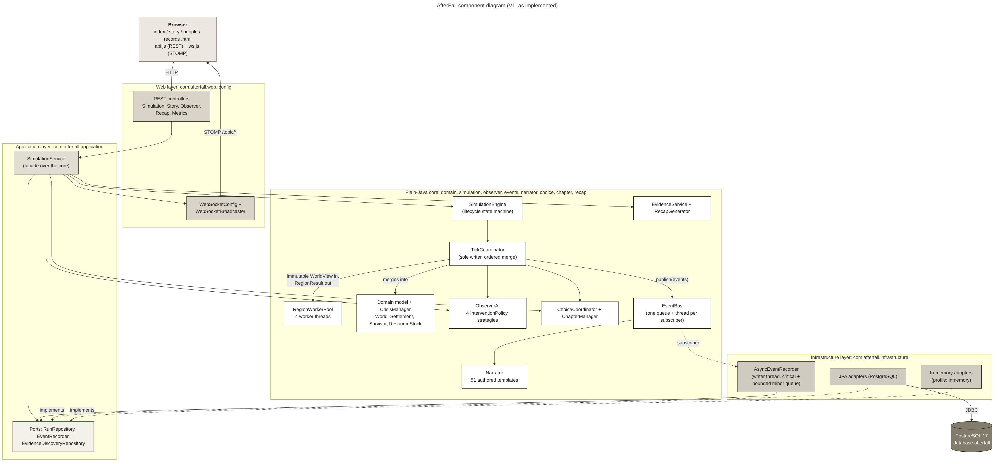
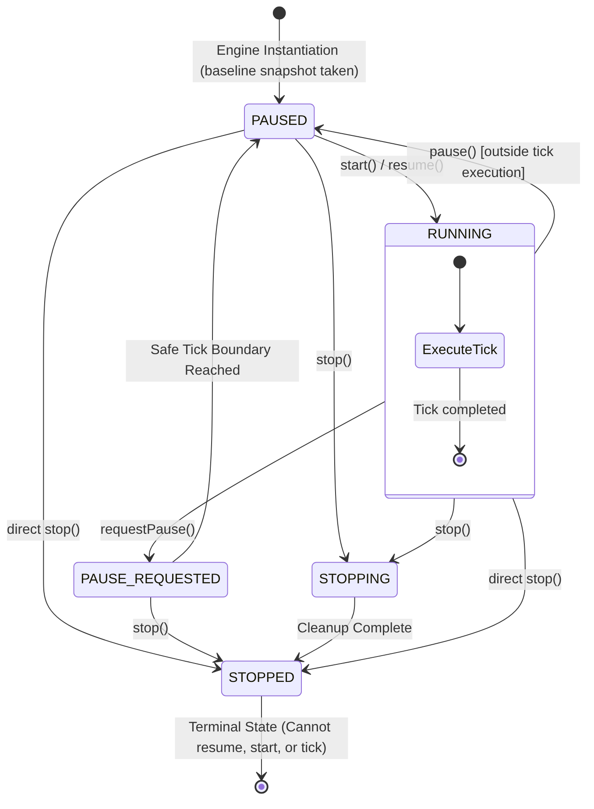

# UML diagrams

Mermaid sources (`.mmd`) with pre-rendered PNGs in [`rendered/`](rendered). GitHub, VS Code (Mermaid extension) and https://mermaid.live all open the `.mmd` files.

| Required type | Source | Image |
|---|---|---|
| Component | [component-diagram.mmd](component-diagram.mmd) |  |
| State machine (engine lifecycle) | [lifecycle-state.mmd](lifecycle-state.mmd) |  |
| Sequence: tick and ordered merge | [tick-sequence.mmd](tick-sequence.mmd) | [PNG](rendered/tick-sequence.png) |
| Sequence: decision and safe pause | [decision-sequence.mmd](decision-sequence.mmd) | [PNG](rendered/decision-sequence.png) |
| Sequence: cross-region handoff | [cross-region-handoff.mmd](cross-region-handoff.mmd) | [PNG](rendered/cross-region-handoff.png) |
| Extra: threads and snapshots | [concurrency-architecture.mmd](concurrency-architecture.mmd) | [PNG](rendered/concurrency-architecture.png) |

## Class diagrams

The whole model has 128 types, which is unreadable on one page, so it is split into five views. Each view shows full members for its own classes and names only for neighbours.

1. [class-domain.mmd](class-domain.mmd): Survivor and its composed parts, Region, Settlement, World ([PNG](rendered/class-domain.png))
2. [class-actions-crises.mmd](class-actions-crises.mmd): Command (`Action`), Strategy (`Behavior`), resources, Template Method (`Crisis`) ([PNG](rendered/class-actions-crises.png))
3. [class-simulation.mmd](class-simulation.mmd): engine, tick coordinator, worker pool, immutable views and results ([PNG](rendered/class-simulation.png))
4. [class-observer-story.mmd](class-observer-story.mmd): Observer policies, EventBus, Narrator, choices, chapters ([PNG](rendered/class-observer-story.png))
5. [class-persistence-recap.mmd](class-persistence-recap.mmd): ports, JPA, in-memory and async adapters, recap ([PNG](rendered/class-persistence-recap.png))

[class-diagram.mmd](class-diagram.mmd) is the full reference. The five views are generated from it, so edit it first.

## Re-render

```
npm i @mermaid-js/mermaid-cli
npx mmdc -i docs/uml/component-diagram.mmd -o docs/uml/rendered/component-diagram.png -w 1800 -s 2 -b white
```

Class and relation names were checked against `backend/src/main/java/com/afterfall`.
